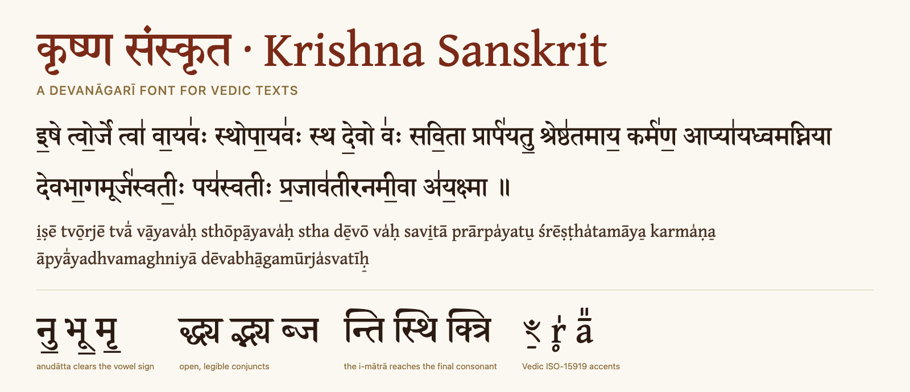

# Krishna Sanskrit · कृष्ण संस्कृत



**Krishna Sanskrit** is a free Devanāgarī font for Vedic and Sanskrit texts. It keeps the
traditional Nirṇaya Sāgara letterforms of Sanskrit2020, fixes how Vedic accents and
conjuncts are drawn, and adds a scholarly Latin (from SIL's Gentium) for ISO-15919 / IAST
transliteration with Vedic accent marks. It was built for the Kṛṣṇa Yajurveda
Taittirīya texts at [sriiyer.com/veda](https://sriiyer.com/veda) and is tested against all of
them: 1.6 million Devanāgarī syllables and 5.3 million transliterated ones.

## Download

Get `KrishnaSanskrit.zip` from the [latest release](https://github.com/iamsridhar/krishna-sanskrit/releases/latest):

| File | Use it for |
|---|---|
| `KrishnaSanskrit-Regular.ttf` | Installing on Windows, macOS or Linux; Word, LibreOffice, XeLaTeX / LuaLaTeX |
| `KrishnaSanskrit-Regular.woff2` + `web/krishna-sanskrit.css` | Websites |

## What it does

- **Vedic accents placed correctly.** The anudātta hangs below u, ū, ṛ, ṝ, ḷ and virama
  instead of colliding with them (नु॒ भू॒ मृ॒); svarita, dīrgha svarita (᳚), anusvāra and
  candrabindu stack cleanly; digits take accents (१॒ ३॑).
- **Legible conjuncts.** Open द्ध, द्ध्य, द्भ्य, द्व्य, द्द्य with a compact, joined ya-phala;
  cramped ligatures such as ब्ज, क्त्र, क्च, च्छ्र, न्त्र, न्त्र्य written clearly; complex द-stacks
  (द्ध्व, द्ध्म, द्ध्र, द्घ्र, द्र्व) written with an explicit द्.
- **Anunāsika conjuncts.** य्ँय, व्ँव, ल्ँल (र॒जव॒व्ँवा) drawn as the joined conjunct with the
  candrabindu over its first part, instead of a visible virama.
- **The i-mātrā (ि) reaches the final consonant** of a conjunct (न्ति, स्थि, क्त्रि, र्स्तिं),
  in 23 lengths chosen per cluster, including the forms merged with reph and anusvāra.
- **Transliteration with Vedic accents.** Every letter and combining accent of ISO-15919
  and IAST, including the Vedic marks ā̠ (U+0320), ā̍ (U+030D), ā̎ (U+030E), r̥ (U+0325),
  m̐ (U+0310) and accents on ꣳ / ꣴ.
- **Copy-paste works.** Text copied out of a PDF made with this font is real Unicode
  (with Sanskrit2020, conjuncts came out as private-use codes).
- **Same result everywhere.** Verified glyph-for-glyph on HarfBuzz (Chrome, Firefox, Edge,
  Android, XeLaTeX) and CoreText (Safari, iOS, macOS); consistent line spacing on Windows
  and macOS; no clipping of tall accent stacks; passes the OpenType Sanitizer and
  FontBakery's universal checks.

## Using it

**Web**: copy `KrishnaSanskrit-Regular.woff2` and `krishna-sanskrit.css` from the `web/`
folder of the release, then

```html
<link rel="stylesheet" href="krishna-sanskrit.css">
<style> .sanskrit { font-family: 'Krishna Sanskrit', serif; } </style>
```

The CSS sets `font-display: swap` and ascent/descent overrides so text doesn't jump while
the font loads. There is no bold yet; avoid `font-weight: bold` or `-webkit-text-stroke`
on Devanāgarī, which only smear the strokes.

**LaTeX** (XeLaTeX or LuaLaTeX):

```latex
\usepackage{fontspec}
\newfontfamily\sanskritfont{Krishna Sanskrit}[Script=Devanagari]
% or, without installing: {KrishnaSanskrit-Regular.ttf}[Path=fonts/, Script=Devanagari]
```

Accents on digits (२॒) render correctly without any workaround.

**Desktop**: install `KrishnaSanskrit-Regular.ttf`. Typing Vedic Sanskrit needs a
Devanāgarī keyboard or input method with Vedic accents (e.g. an ITRANS or Baraha input
method, or the Sanskrit2020 KbdEdit layout).

## Licence

Krishna Sanskrit is licensed under the **[SIL Open Font License 1.1](OFL.txt)**. In short:

- **You may** use it for anything, personal or commercial: websites, apps, books, PDFs,
  print, video. You may embed it, bundle it with software, and redistribute it.
- **You may** modify it and share your version, as long as your version is also under
  the OFL and **does not use the names "Gentium" or "SIL"** (reserved by SIL Global).
- **You may not** sell the font files on their own (bundling them with something else is
  fine).
- **You must** keep the copyright notices and the licence with any copy of the font
  files.
- Documents you make with the font are yours; the licence places no conditions on them.

It combines work by several people, all credited below and in the font itself.

## Credits

- **Omkarananda Ashram Himalayas**: Sanskrit 2003, the Devanāgarī design this font is built on.
- **advaita56**: Sanskrit2020, which extended it with Vedic Extensions and Devanāgarī Extended.
- **IIT Bombay (SandHI)**: Shobhika, source of the open द्ध-family glyphs.
- **SIL Global**: Gentium, source of the Latin.
- **The Krishna Sanskrit Project** ([sriiyer.com/veda](https://sriiyer.com/veda)): the fixes,
  testing and release engineering in this repository.

See [upstream/README.md](upstream/README.md) for exactly what comes from where.

---

## How it is built

The font is not redrawn from scratch. `build.py` downloads the source fonts from their
official releases (pinned by SHA-256, see [upstream/README.md](upstream/README.md)) and:

1. applies small, reviewable **patches** from `patches/` to Sanskrit2020;
2. replaces the bundled URW Palladio Latin (AGPL/GPL, not OFL-compatible) with
   **Gentium Medium** Latin, scaled to Sanskrit2020's x-height (`krishnatools/latin.py`);
3. applies the final patches (vertical metrics over the merged font);
4. **production**: every glyph is named for the text it renders
   (`uni0926094D0927094D092F` for द्ध्य) and upstream's private-use cmap entries are removed,
   so PDF text is Unicode; then `ttfautohint` hints every glyph consistently.

| Patch | What it does |
|---|---|
| `p00_rename` | Names the font Krishna Sanskrit, credits all sources, drops the stale DSIG and legacy Mac names. |
| `p05_ots_null_anchors` | Gives upstream's NULL mark anchor (U+1CED) an explicit (0,0) so GPOS passes the OpenType Sanitizer. No visual change. |
| `p10_anudatta_below_vowel` | Hangs anudātta (U+0952) under u/ū/ṛ/ṝ/ḷ/ḹ vowel signs and virama instead of overlapping them. |
| `p15_shobhika_da_stacks` | Redraws द्ध, द्ध्य, द्भ्य, द्व्य, द्द्य from Shobhika's outlines (open stack, compact joined ya-phala), fitted to Sanskrit2020's size, weight and headline. |
| `p20_conjunct_decompose` | Splits cramped fused conjuncts into upstream component glyphs: ब्ज क्त्र क्च च्छ्र ञ्छ्र न्त्र न्त्र्य → half form + letter; द्ध्व द्ध्म द्ध्र द्घ्र द्र्व → द् + rest; leftover below-ra (र्र्ष) → र्. |
| `p25_pra_rakar` | प्र: longer, more visible rakar stroke (outline edit; covered by `tests/test_rakar.py`). |
| `p30_long_i_matra` | 23 longer i-mātrā hooks (also for the ि + anusvāra/candrabindu/reph forms), chosen per conjunct so the hook lands on the final consonant. Single consonants keep the upstream ि. |
| `p40_anunasika_conjunct` | य्ँय, व्ँव, ल्ँल (anunāsika before y/v/l) as the joined conjunct with the candrabindu over its first part; with ि the candrabindu is lifted above the i-mātrā arc. Spans two syllables, so it uses `rlig`; covered by `tests/test_anunasika.py` rather than the per-cluster tests. |
| `p95_composite_hygiene` | Removes a duplicate component (U+0957) and flattens a nested composite (U+0977). No visual change. |
| `p90_vertical_metrics` (final) | USE_TYPO_METRICS, typo = hhea with the line gap folded in (same line height), usWin covering the full bounding box. |

Each patch declares, via `affects(cluster)`, which text clusters it may change; the tests
fail if anything else changes.

```bash
python3 -m venv venv && venv/bin/pip install -r requirements.txt
venv/bin/python build.py            # -> build/KrishnaSanskrit-Regular.{ttf,woff2}, build/web/
venv/bin/python -m pytest -q        # regression + release suite (~25 s)
venv/bin/python tools/proof.py --patch p10 --png   # before/after proof in proofs/
```

## Tests

`tests/data/clusters.tsv` holds every unique Devanāgarī cluster (with frequency) from the
sriiyer.com Veda corpus (Saṃhitā, Pada, Krama, Brāhmaṇa, Āraṇyaka, Kāṭhakam, Ekāgnikāṇḍam,
Sūktāni), and `tests/data/iso_clusters.tsv` every transliterated letter + accent cluster.
Regenerate both with `tools/export_corpus.py` after the site build.

- `test_roundtrip.py`: the rename-only build shapes every cluster exactly like upstream.
- `test_scope.py`: every rendering change is claimed by some patch.
- `test_quality.py`: no new missing glyphs or dotted circles, no conjunct regressions, no
  anudātta collisions outside a short documented list.
- `test_imatra.py`: every conjunct's i-mātrā hook lands within 180 units of its final
  consonant (also for unseen 4-consonant clusters); the stretch only moves the arc.
- `test_release.py`: the Latin merge and production steps change no Devanāgarī rendering;
  every ISO cluster renders, with accents placed exactly as Gentium places them (and
  centred on ꣳ/ꣴ); glyph names decode to their text; no PUA mappings; vertical metrics;
  every glyph hinted; OTS accepts every shipped file; PDF copy-paste is Unicode
  (needs xelatex).
- `test_engines.py` (macOS, `KRISHNA_ENGINES=1`): CoreText shapes every corpus cluster
  exactly like HarfBuzz, apart from differences upstream already has.

## Continuous integration

`.github/workflows/build.yml` builds, runs the tests (with XeLaTeX), runs FontBakery's
universal profile (fails on any FAIL), and uploads `KrishnaSanskrit.zip`. Pushing a `v*`
tag publishes it as a GitHub Release. A macOS job checks CoreText agreement.

## Reviewing on the real site

`tools/preview_site.py` serves a local sriiyer.com checkout twice: `:8800` as-is and
`:8801` with every Devanāgarī font stack switched to Krishna Sanskrit.
`tools/compare_engines.py` prints the CoreText vs HarfBuzz report.

## Renderer notes

- DirectWrite shaping (desktop Windows apps such as Word) is not yet verified.
- New lookups are registered in `psts`, the last presentation feature: HarfBuzz applies
  presentation lookups in lookup order, CoreText feature by feature.
- CoreText does not skip ZWJ when matching contexts, so the i-mātrā rules include
  explicit ZWJ variants.

## Adding a patch

1. Create `patches/pNN_short_name.py` with `ID`, `SUMMARY`, `apply(font)`, `affects(cluster)`.
2. Register it in `patches/__init__.py`.
3. Add a test for what it fixes, run `pytest`, then review `tools/proof.py --patch pNN --png`.
4. Add an entry to `FONTLOG.txt`.
